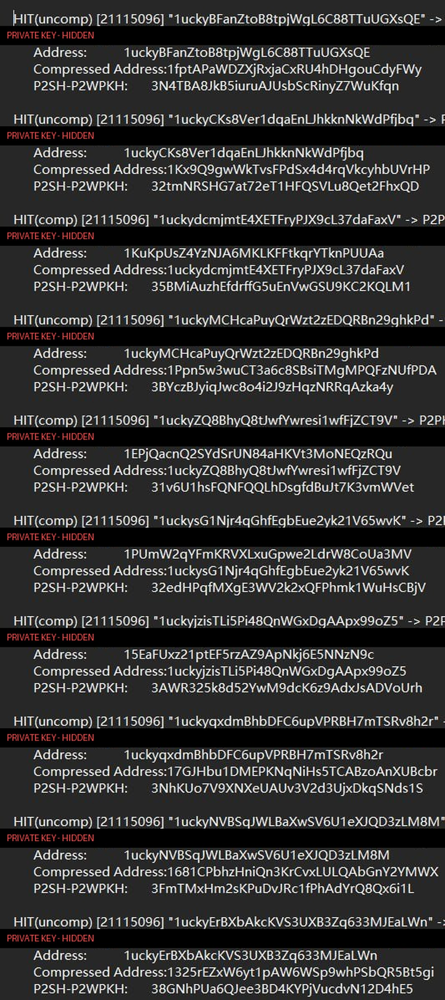

# BTC Triple-Address Vanity Generator（btc_vanity_dual.exe）

> 💖 赞助开发：BTC 赞助地址与社区币 BITCAT (BCT) 的 pump.fun 融资信息见文末「赞助与支持 / Sponsor」章节。

**三型地址版**：随机私钥 → 同时计算 **3 种地址**，全部参与前缀匹配，命中打印：

```
Private Key (WIF) | Address | Compressed Address | P2SH-P2WPKH
```

## 3 种地址类型（同一私钥）

| 类型 | 公钥形式 | 地址前缀 | 长度 |
|---|---|---|---|
| **Address**（BTC Uncompressed） | 未压缩公钥 `04|X|Y` → hash160 → Base58 | `1` | 34 |
| **Compressed Address**（BTC Compressed） | 压缩公钥 `02/03|X` → hash160 → Base58 | `1` | 34 |
| **P2SH-P2WPKH**（嵌套 SegWit） | 压缩公钥 hash160 → redeemScript(`00 14 <h160>`) → scriptHash → Base58(`0x05`) | `3` | 34 |

- **WIF 为 uncompressed 格式（5 开头）**，与 Address 列对应
- 任一地址匹配前缀即命中；同一私钥可同时命中多个不同前缀（各计一次）
- 前缀文件可**混含 `1` 开头和 `3` 开头前缀**（按字符复核天然分离，`3` 开头前缀只会匹配 P2SH-P2WPKH 地址）
- 前缀长度上限 34 字符
- file 模式支持超大前缀文件（64 位计数 + 去重压缩 + 环形队列，2G+ 可加载）
- 无限运行：**全部前缀命中后不退出**，持续搜索、同一前缀可反复命中并持续记录，仅 Ctrl+C 停止
- 实时 addr/s 与累计命中数显示
- **每次启动随机起点**（高分辨率时钟纳秒 + 进程计数混合），两次运行私钥序列完全不同；链内仍为增量点加枚举（BitCrack 式），实测 **~500 万 addr/s（纯计算）/ ~280 万 addr/s（含三查表）**

---

## 编译

```bat
nvcc -O2 -arch=sm_89 -Xcompiler=/utf-8 -o btc_vanity_dual.exe btc_vanity_dual.cu
```

## 命令一览

| 命令 | 作用 |
|---|---|
| `btc_vanity_dual.exe bench [iters] [blocks]` | 三地址生成吞吐测试 |
| `btc_vanity_dual.exe vanity <prefix> [blocks]` | 单前缀无限搜索 |
| `btc_vanity_dual.exe file <prefix_file> [blocks]` | 文件多前缀无限搜索 |

> 固定三型地址（无 addrtype 参数）；默认 blocks=1024（甜点值）。

## 用法示例

```bat
:: 单前缀：任一地址（1 或 3 开头）以 1abc 开头
btc_vanity_dual.exe vanity 1abc

:: 匹配 3 开头（P2SH-P2WPKH）
btc_vanity_dual.exe vanity 3abc

:: 文件模式：每行一个前缀，可混含 1/3 开头
btc_vanity_dual.exe file my_pfx.txt

:: 测速
btc_vanity_dual.exe bench 200 1024
```

## 命中输出格式

```
HIT(p2sh_p2wpkh) [ 302] "3LcYcFfdNnesH5UJR1PusS4tTcBThA2Jn6" -> P2PKH/P2SH
      Private Key (WIF): 5K9WFH1VPCQCbcNgFEnmYJC3y3EwM4QDmXy4THiNV6to7SFZsZL
      Address:           18QVBrof6hM6N5XNnV3MdPMAAZdJza7QoM
      Compressed Address:1Ed9VQ7jvd5L6yi5jtX68gxQJVC6NqGT4k
      P2SH-P2WPKH:       3LcYcFfdNnesH5UJR1PusS4tTcBThA2Jn6
```

- `HIT(uncomp)` = 未压缩 P2PKH 地址匹配；`HIT(comp)` = 压缩 P2PKH 匹配；`HIT(p2sh_p2wpkh)` = 嵌套 SegWit 匹配
- WIF 是 uncompressed（5 开头）；四个值属于同一私钥，WIF 可直接导入钱包恢复

### 真实命中样例（1ucky 前缀）

下面是工具一次实际运行的命中输出（搜索前缀 `1ucky`；同一私钥三型地址任一命中即记录。**图中 Private Key 行已打码遮盖**——真实使用时请勿截图分享未打码的命中输出）：



## 命中自动写文件

- **每次命中立即追加写入 `btc_hits.txt`**（程序同目录，追加模式，不覆盖旧结果）
- 无缓冲实时落盘：进程运行中/被 Ctrl+C 强杀，已命中记录都不会丢
- 文件内容与屏幕输出一致（HIT 行 + WIF + 三地址 + 空行分隔），可直接用脚本解析或备份

## file 模式

- 文件每行一个前缀，行首空白忽略，遇 `#`/空格截断，空行跳过；超过 34 字符的行自动跳过计数。
- **超大文件支持**（2G+ / 5000 万行实测可加载）：u64 计数、去重就地压缩、固定环形结果队列。
- 前缀以 `1` 开头匹配 P2PKH 两种地址，以 `3` 开头匹配 P2SH-P2WPKH。

## 实时显示 / 停止

- 每秒刷新：`[运行秒数] xxx addr/s | hit 累计命中数`；**Ctrl+C 随时停止**。
- **永不自动退出**：即使前缀全部命中过，程序仍继续搜索并持续记录重复命中（去重按"每轮"计，轮间可重复命中同一前缀）。

## 性能（实测 RTX 4080 SUPER，blocks=1024）

| 场景 | 吞吐 |
|---|---|
| bench 纯计算（三地址） | ~500 万 addr/s |
| vanity 单前缀（含三查表） | ~280 万 addr/s |
| file 303 前缀（含三锚，1/3 混合） | ~283 万 addr/s |

三地址纯计算 ~500 万（与单地址版持平，主要瓶颈是点运算）；查表成本为三份但命中面也 ×3（匹配概率更高）。

## 正确性验证

开发期用确定性起点（nonce=0 → priv = sha256(0x00×8)）与独立 Python 手写实现逐字节一致，三型地址均 1:1 命中（vanity 单前缀 + file 多前缀混合文件均验证通过）：

- priv `af5570f5a1810b7af78caf4bc70a660f0df51e42baf91d4de5b2328de0e83dfc`
- WIF(uncomp) `5K9WFH1VPCQCbcNgFEnmYJC3y3EwM4QDmXy4THiNV6to7SFZsZL`
- Address(uncomp) `18QVBrof6hM6N5XNnV3MdPMAAZdJza7QoM`
- Compressed Address `1Ed9VQ7jvd5L6yi5jtX68gxQJVC6NqGT4k`
- P2SH-P2WPKH `3LcYcFfdNnesH5UJR1PusS4tTcBThA2Jn6`

> 注：正式版每次启动随机起点，上述锚地址只作为算法正确性的历史验证记录；随机序列下首次命中时刻/私钥每次不同属正常。

---

## 赞助与支持 / Sponsor

本工具免费开源。欢迎通过以下两种方式支持作者继续开发：

### 1. 比特币赞助 (BTC Donation)

```
bc1qt05te48lf7a6qsyurx2ulz8u5qzh5xs6hc7l3z
```

> 注意：请勿向"正确性验证"章节里的示例地址转账——那是公开种子推导出的测试锚地址，任何人都能算出它的私钥，转过去等于送人。

### 2. pump.fun 社区融资 (BITCAT)

本项目的社区币 **BITCAT (BCT)** 已在 pump.fun 发行，这是本项目的社区融资/赞助渠道：买入或持有 BITCAT 即视为对本项目的赞助，创建者收益将用于本工具的持续开发与算力开销。

- 合约地址 (CA)：`6o2ayvqJZuJh96GV5BJUcb3AwuXbJ5jtzC7pHh3Bpump`
- 交易页面：https://pump.fun/coin/6o2ayvqJZuJh96GV5BJUcb3AwuXbJ5jtzC7pHh3Bpump

> 风险提示：BITCAT 是社区赞助性质的 meme 币，价格波动剧烈，不构成投资建议，也没有任何收益承诺。请仅在"赞助作者"的前提下，自行决定是否参与。

## 安全提醒

- 私钥只在本地 GPU/内存中生成与打印，不上传网络；命中后立即备份 WIF。
- WIF 为 uncompressed（5 开头），导入钱包时选"未压缩"格式。
- 前缀越长期望时间越长；短前缀（如 `1abc`/`3abc`）几乎秒级命中。
